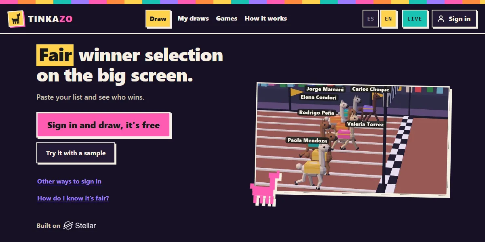
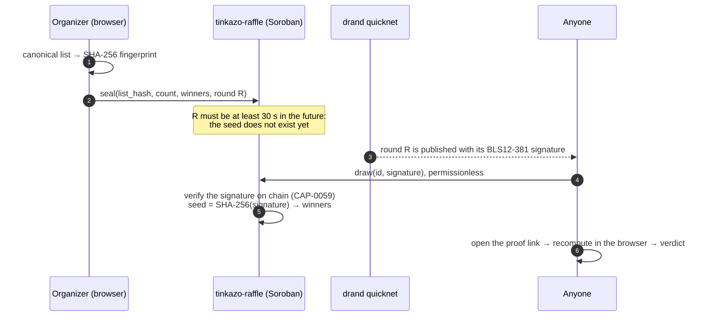
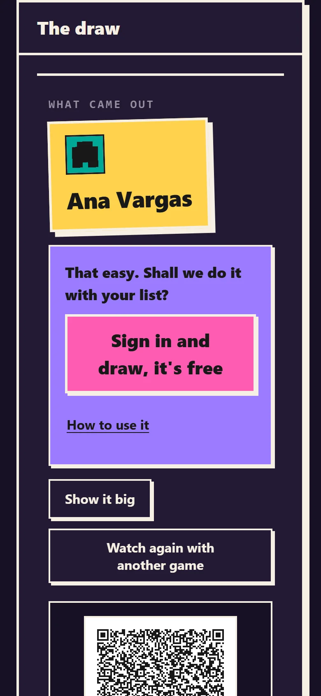
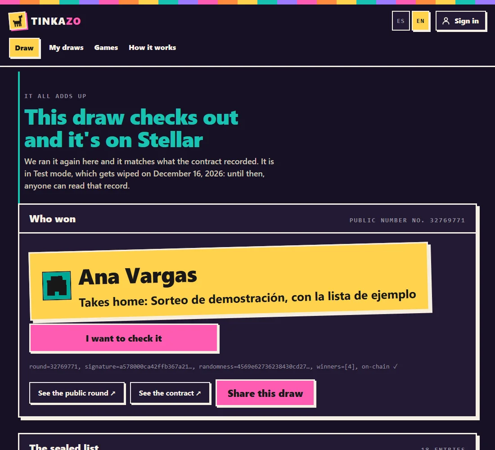
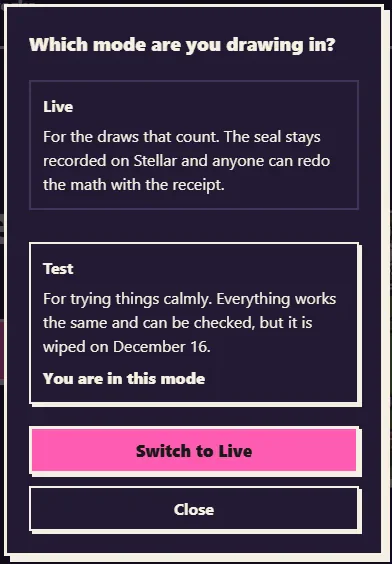
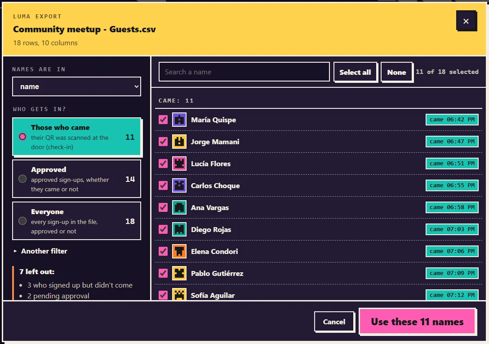
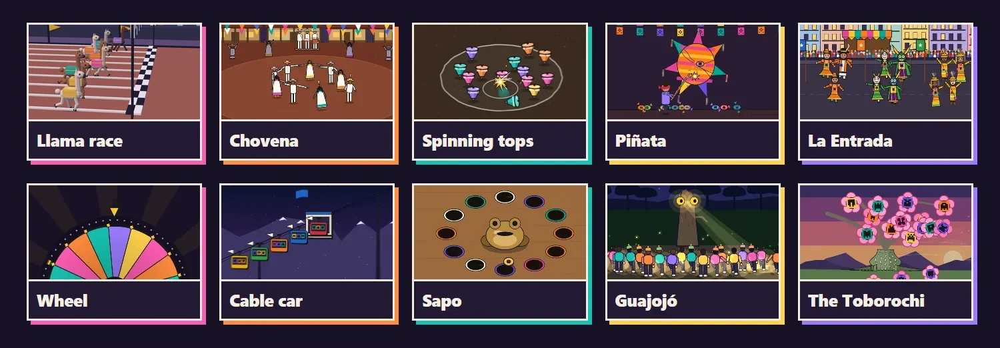

<div align="center">

# Tinkazo 🦙

### Verifiable winner selection for communities and promotions, sealed before the randomness exists and checked on Stellar.

[](https://tinkazo.app)
[](https://stellar.expert/explorer/public/contract/CANQLUVTYYZWHT2L75VDW27CWU2LKWB6EBK2AHSMHGIDRC5XSF2EVL3K)
[](https://stellar.expert/explorer/testnet/contract/CDNWNY26VWXM7ISXJD2OFWDUAPIOAJTR5TMAXFFHWWUHZWGCEWDKYV3A)
[](https://github.com/nema1502/tinkazo/actions/workflows/ci.yml)
[](https://drand.love)
[](LICENSE)

**[Try it](https://tinkazo.app)**, [How it works](#how-it-works), [Check a draw](#check-a-draw), [Security](#security), [What is live](#what-is-live-today), [Costs](#costs), [Run it locally](#run-it-locally), [Español](README.es.md)



</div>

---

Every community has things to share out: conference tickets, books, software licenses, scholarships, speaking slots, who presents first. And every time, someone in the room wonders whether the organizer picked a friend. The tools people use today are a spreadsheet `RAND()`, a spinning wheel on a website, or "trust me". None of them can be checked afterwards. And the winner rarely has a way to know the selection was fair.

**Tinkazo makes the draw checkable by anyone, from their phone.** The organizer pastes a list, the list is sealed on Stellar, and the winner comes from a public random number that did not exist yet when the list was sealed. A Soroban contract verifies that number's signature on chain. The result is shown on the big screen as a full-screen animated reveal, and anyone can re-run the whole draw in their browser from a link.

**The contract has been live on Stellar's main network since November 11, 2026**, at [`CANQLUVT…VL3K`](https://stellar.expert/explorer/public/contract/CANQLUVTYYZWHT2L75VDW27CWU2LKWB6EBK2AHSMHGIDRC5XSF2EVL3K). The site opens in Test mode, on Stellar's test network, and Live mode is one tap away in the header.

Participants need nothing: no wallet, no account, no app.

The draw is where it starts. What Tinkazo is for is broader: whenever people share something out (a prize, a speaking slot, a grant, a spot on a trip), it should be fair, and anyone should be able to check it from their phone, without knowing there is a blockchain underneath.

## Participation is free

Tinkazo selects who receives something that is already being given away. Nobody pays to take part:

- **Entering is free, always.** No entry fees and nothing to buy. The [terms](https://tinkazo.app/terminos.html) forbid using Tinkazo for draws that charge to take part.
- **Nobody puts money in.** The prize comes from the organizer or a sponsor, never from the participants, so nobody's winnings come out of other participants' pockets.
- **The contract holds no funds.** It stores a list fingerprint and a result, nothing else.
- **Tinkazo never touches what is shared out.** The organizer hands it over, as always, and Tinkazo takes no cut of it.

Joining a draw is free, always, with nothing to buy. The legal framework, country by country, is in [docs/legal.md](docs/legal.md). A few identifiers in the contract still say *raffle* (`tinkazo-raffle`, `raffle_id`), from before the name settled. They are part of the deployed contract's interface, so they stay.

## How it works



1. **Seal.** The list is canonicalized and hashed with SHA-256. The contract records, among other things, the fingerprint, the head count, the number of winners and a **future** drand round. The contract refuses a round less than 30 seconds away.
2. **Wait for the number.** [drand](https://drand.love) quicknet, the public randomness beacon run by the League of Entropy (Cloudflare, Protocol Labs, EPFL and others), publishes a BLS-signed round every 3 seconds. Nobody, including the organizer and Tinkazo, can know or choose it in advance.
3. **Draw.** `draw` verifies the round's BLS12-381 signature **inside the contract** with a pairing check, derives the seed and selects the winners deterministically. It asks nobody for permission: if the organizer disappears mid-event, anyone can finalize the draw and the winner is the same.
4. **Show.** One of ten full-screen reveals tells the result. The winner is already fixed when the animation starts; the reveal only narrates it.
5. **Verify.** The proof is a link. Whoever opens it watches the page recompute the draw from scratch and gets a verdict: green if the contract attests the list, yellow if the draw was not anchored, red with the reason if anything does not match. If you ran several draws at the same event, the [event link](docs/evento.md) puts them on one page.

The full selection algorithm is a normative spec, [Protocol v2](docs/protocolo.md) ([English translation](docs/protocol.en.md)), with test vectors shared by the Rust contract and the TypeScript client ([docs/vectors.json](docs/vectors.json)). Anyone can reimplement it and reach the same winners.

## Check a draw

- **With the proof link.** Every draw ends with a link to the verification page. Opening it recomputes the draw from scratch in the browser and gives the verdict. Checking is free, and it needs no account.
- **Without Tinkazo.** The seal and the result are public on stellar.expert, the round is on drand's public API, and the selection is in the [protocol](docs/protocol.en.md). The site explains how to put them together [without going through Tinkazo](https://tinkazo.app/como-funciona.html#sin-nosotros).
- **From the history archives.** `node scripts/verificar-archivo.mjs <network> <tx hash>` reads the public Stellar history archives of several organizations and confirms that a seal or draw transaction was in a ledger and when it closed. Green only when two organizations return the same ledger header ([protocol §7.2](docs/protocol.en.md)).

<div align="center">


</div>

## Why Stellar

- **Verifying public randomness on chain is cheap here.** Stellar's native BLS12-381 host functions ([CAP-0059](https://github.com/stellar/stellar-protocol/blob/master/core/cap-0059.md)) let the contract check drand's signature itself. The verification itself costs **0.003 XLM** (measured on testnet on October 3, 2026). The rest of a draw's cost is storage rent, which the network sets and has changed more than once ([history, with dates](docs/deployments.md)). On mainnet, a three-winner draw is projected at 0.178 XLM ([costs](#costs)).
- **No oracle to run.** The proof is drand's own signature, checkable against its public key years from now. There is no node to keep alive and no operator to trust.
- **Immutable and custody-free.** The contract has no admin, no upgrade path and holds no funds. A new version is a new address: mainnet runs version 0.2.0 at its own address, and every deployment is recorded in [docs/deployments.md](docs/deployments.md).
- **Onboarding that works at a meetup.** In Test mode, organizers sign in with Google through Pollar, which holds the key for them, with Freighter, or with a test account the browser creates and funds, and Tinkazo covers the network fee. In Live mode, organizers sign in with their own wallet and pay the network fee from it, a few cents. The test account works only in Test mode. Participants never touch Stellar at all.

## What is live today

**Two modes.** The site opens in **Test** mode, on Stellar's test network: everything works the same and every draw can be checked, but Stellar wipes that network on December 16, 2026. **Live** mode, picked from the header, seals on Stellar's main network, for the draws that count. A link with `?red=oficial` opens straight in Live mode.

<div align="center">

</div>

| Component | Status | Evidence |
|---|---|---|
| Soroban contract `tinkazo-raffle` on mainnet | Deployed on November 11, 2026, version 0.2.0, up to 300 winners per draw | [`CANQLUVT…VL3K`](https://stellar.expert/explorer/public/contract/CANQLUVTYYZWHT2L75VDW27CWU2LKWB6EBK2AHSMHGIDRC5XSF2EVL3K), the 11,737-byte WASM of the `v0.2.0` release built by GitHub Actions ([how to check the build](docs/deployments.md#verificar-la-compilación)) |
| Soroban contract on testnet | Deployed on October 25, 2026, up to 32 winners per draw. Stellar wipes testnet on December 16, 2026 | [`CDNWNY26…YV3A`](https://stellar.expert/explorer/testnet/contract/CDNWNY26VWXM7ISXJD2OFWDUAPIOAJTR5TMAXFFHWWUHZWGCEWDKYV3A), 11,687-byte WASM |
| Web app | Live | [tinkazo.app](https://tinkazo.app), Test and Live modes, Spanish and English, light and dark, no backend for the draw (short links run on a small Cloudflare Worker, [workers/enlaces](workers/enlaces/README.md)) |
| Luma import | Live | Drop the guest export and pick who gets in: those who checked in, the approved ones, or by hand |
| Verification page | Live | Recomputes any draw in the browser from its proof link ([Check a draw](#check-a-draw)) |
| Organizer guide | Live | [tinkazo.app/sorteo-para-meetup.html](https://tinkazo.app/sorteo-para-meetup.html), in Spanish and English, with printable cards for the tables ([docs/kit-organizador.md](docs/kit-organizador.md)) |
| Ten animated reveals | Live | Deterministic: the same round draws the same frames on any machine |
| Protocol v2 | Specified | [docs/protocolo.md](docs/protocolo.md) ([in English](docs/protocol.en.md)) and shared vectors that both implementations must pass |
| Quality gates | Tests in CI, auditors before every push | More than 7,400 TypeScript tests and 26 contract tests, including a real quicknet round, run in CI; 24 auditors in [`scripts/`](scripts) (below) run against the built site |

Tested with a thousand participants (September 22, with the previous engine): the draw ran at 60 frames per second and anchored the same way. Today's reveals are built for up to 200 names on screen.

**Who was actually in the room.** In the first real Luma export we tried, 67 people had registered and 35 checked in. Drawing from the whole export would have given people who were not there half of the places in the draw. The import window proposes those who checked in, says who is left out and why (didn't come, pending, invited, declined), and lets the organizer tick someone who came but was never checked in. The file never leaves the browser, and only names go into the draw.

<div align="center">

<br><sub>The window with a sample export of 18 rows.</sub>
</div>

## The show

Fairness is math; the reveal is what makes a room care. Ten reveals, most of them rooted in Bolivian and Latin American culture, each seeded with the same drand round, so a draw's animation is reproducible:

<div align="center">

</div>

| Reveal | What it is |
|---|---|
| Llama Race | Eight lanes to the finish line |
| Chovena | The Chiquitano dance from Santa Cruz: the ring turns hand in hand, and when the band cuts the music, whoever stumbles lets go and sits down at the edge of the plaza. The one reveal where the room claps along and freezes with the cut |
| Spinning Tops | The schoolyard game: tops thrown into a chalk ring clash and knock each other out, down to a head-to-head |
| Sapo | The frog toss from fairs and patios: a hole for each name around the frog; rings hit, dance on a rim and roll out, and the last one drops into the selected name's hole |
| Piñata | The seven-pointed star from the posadas: every swing knocks names out, and the last candy inside is the one selected |
| La Entrada | A Diablada troupe dances block by block toward the Socavón; a few stay at every arch |
| Cable Car | Cabins in the colors of the La Paz and El Alto lines climb the cable, one per group; at each station a whole group gets off |
| Guajojó | A forest trail at night: while the guajojó sings, everyone walks; when it goes quiet, they freeze, and whoever snaps a twig sits down. The one still standing at dawn is selected |
| Toborochi | The toborochi in bloom, the tree of Santa Cruz: names arrive eight at a time and the south wind carries the flowers off little by little, until the finalists remain |
| Wheel | The classic, readable even with two people |

**None of them decides anything.** An *emotion director* writes each draw's story from the same round: in the race a llama stops dead, another trips and two spit at each other; the wheel stops on someone else and then slips one more slice; in the cable car the power goes out mid-air. The ending cannot be guessed, and an auditor checks across sixteen seeds per game that the story does not give the winner away.

A camera director frames every reveal like a broadcast: it follows the leader, pushes in on the scare, slows down for the photo finish and shakes on impact. The reveals run on PixiJS, and where a device has no WebGL the previous engine takes over, so a draw never goes blank.

Andean music with a beat plays in the background and follows the tension (the Chovena brings its own Chiquitano music, with a cane flute, a leather-snared drum and a bass drum, and its cut is the game itself), and goes silent for a breath right before every winner; short captions call each moment on screen, and after the winner a card explains a piece of the story with its primary source.

## Security

> **The number that decides the draw does not exist when the list is closed, and a contract on Stellar verifies it.** What stays open is not technology, it is people: that is why everything is shown before that number exists.

**What is closed**

| Risk | Why it can't happen |
|---|---|
| Choosing the winning number | The round is fixed before it exists, at least thirty seconds ahead, and its signature is verified on chain |
| Changing the list after sealing | The fingerprint changes, and the one that counts was recorded before the seed |
| Withholding an unwanted result | `draw` is permissionless: anyone can finalize it, and the winner is the same |
| Drawing twice | The contract keeps the first result and rejects another |
| A reveal showing another winner | Reveals receive the winner already decided, and an auditor checks it in all ten |
| Taking over the contract | It has no admin, it can't be upgraded and it holds no funds |

**What stays open, and what stands against it**

| Risk | What there is |
|---|---|
| **Building the list wrong** before sealing: a name twice, someone missing | "Show the list on the big screen": the list on the projector with duplicates flagged and a QR so everyone can find themselves on their phone. The receipt has the same search box, and the Luma import proposes only those who checked in |
| **Sealing several times** and publishing the convenient result | The draw number is shown big during the wait, so it ends up in the photos. The verification flags repeated seals from the account and the same list sealed from another |
| **A fake site** on the projector | What counts is the contract, and a fake site can't write to it. The draw can be checked on stellar.expert and with drand's public round, [without going through Tinkazo](https://tinkazo.app/como-funciona.html#sin-nosotros) |

Mainnet runs version 0.2.0 of this contract, which changes two things from the one on testnet: up to 300 winners per draw instead of 32, and a draw's entries renewed to 120 days ([deployments](docs/deployments.md)). It does not cap open draws per account or let anyone cancel one, and the round is picked by whoever seals (the contract only requires it to be at least thirty seconds away). Since it cannot be upgraded, any of that would take a new contract at a new address. The full STRIDE analysis is in [docs/amenazas.md](docs/amenazas.md) ([summary in English](docs/threat-model.en.md)), and the plain-language version on the [security page](https://tinkazo.app/seguridad.html).

**Privacy.** The chain keeps the list's fingerprint and other draw data, never the names. The proof travels in the URL fragment, which browsers do not send to servers. The site counts visits with Vercel Web Analytics, without cookies, and cuts every address down to its path before counting ([src/analytics.ts](src/analytics.ts)). Sharing or showing the result big makes a short link, which stores on Cloudflare a copy encrypted in the browser, with the key only in the link's fragment: Tinkazo can't read it. It doesn't expire, so the draw can be checked again; if someone needs it deleted, they ask at hola@tinkazo.app ([workers/enlaces](workers/enlaces/README.md)).

## How it compares

Randomness from drand on Stellar is already solved more than once, and it is worth naming who solved it:

| | Spreadsheet or wheel website | [Stellar-VRF](https://github.com/NibrasD/Stellar-VRF) | [Drand-Relay](https://github.com/kaankacar/Drand-Relay) | Tinkazo |
|---|---|---|---|---|
| What it is | A button | An oracle: a contract asks, an off-chain worker delivers the round | A relay that posts drand rounds and a contract that verifies them | A draw for an organizer and a room |
| Who can verify | Nobody | Anyone reading the chain | Anyone reading the chain | Anyone with the link, from a phone |
| Infrastructure to run | None | The oracle worker | The feeder that posts rounds | None: the browser builds the transaction |
| Built for | Anyone, unverifiable | Other contracts | Other contracts | Communities sharing out turns, spots and prizes |

All three verify drand quicknet's BLS signature on chain with CAP-0059. Stellar-VRF and Drand-Relay are primitives for other contracts, and good ones. Tinkazo is the end-user product on top of the same idea: a list committed before the seed exists, a `draw` anyone can trigger, and a proof page that runs on a phone. Off chain, [Wallop](https://wallop.run) does commit and drand for draws without a ledger.

That is why Tinkazo does not publish yet another verifier crate. Its on-chain check, [`drand.rs`](contracts/raffle/src/drand.rs), is 112 lines; what the ecosystem is asking for is a guide that compares the approaches ([stellar-docs#2874](https://github.com/stellar/stellar-docs/issues/2874)), and that is in the plan below.

## Costs

What a draw costs is set by the network, not by us, and it moves. Almost all of it is storage rent, and Stellar changes that rate: on September 16, 2026 the same contract paid 0.18 XLM per draw on testnet, three weeks later testnet rent had quadrupled it, and on October 25 it jumped far higher when the network's live state crossed its target, until the network raised that target. The one part that stays put is the BLS verification: **0.003 XLM**, measured on testnet on October 3, 2026.

On mainnet, from [docs/deployments.md](docs/deployments.md):

| What | XLM | How it was obtained |
|---|---|---|
| Uploading the contract code | 14.2453 | Charged by the network, November 11, 2026 |
| Creating the contract instance | 0.0178 | Charged by the network, November 11, 2026 |
| A draw with 3 winners (`seal` + `draw`) | 0.178 | Projected from simulations, not yet measured on mainnet |
| A draw with 100 winners | 0.331 | Projected |
| A draw with 300 winners | 0.647 | Projected |

The projections hold while the network's live state stays under 2,000 MB (it was at 1,608 MB on November 11, 2026). Above that, rent multiplies, and docs/deployments.md has the table for each level. In Live mode the organizer's wallet pays the fee; in Test mode Tinkazo covers it. **Taking part and verifying are always free.**

## Quality

24 auditors in [`scripts/`](scripts) run the real site in headless Chrome. These are the main ones:

- **Reveal auditor**, 20 checks per reveal against live drand. The one that matters: the name on screen is the one the protocol fixed.
- **Strict auditor**, which swaps the browser clock to compare two runs frame by frame: same round, same frames, no `Math.random`, never four seconds without something happening, a readable winner plate from the back of the room, with two people and with two hundred, on a phone.
- **Emotion auditor**, sixteen seeds per game: the story arcs vary and the winner's mid-race position does not give it away.
- **Sound auditor**, which hooks every oscillator and measures the effects' pitch, register, volume and gaps, with the music counted apart.
- **UI auditor**, desktop and phone, both themes: broken images, clipped text, contrast, tap targets.
- **Physics auditor**, for the ball drum and the aguayo, two reveals that left the selector but still open with `?demo=`: nobody overlaps, nobody escapes, and the same round gives the same bounces.
- **Collision auditor**, for the spinning tops: every hit really touches, with action and reaction, and nobody passes through anybody.
- **Identification auditor**, with 8, 18 and 50 people: how many get to read their own name before the winner.
- **Mix auditor**, which records what comes out of the speaker and measures loudness by the BS.1770 standard, peaks, how much a projector speaker loses and the winner's hit.
- **Flow auditor**, the UX QA: it goes through the real flow with a test account on five screen sizes plus 200% zoom, and checks that every step has one main action in view without scrolling, that the "what's next" bar never hides the button it stands for or the page footer, and that nobody gets lost ([`docs/ux.md`](docs/ux.md)).

## What comes next

Each item has a check anyone can run from outside:

| Item | Done when |
|---|---|
| Five real draws on mainnet, at least three run by someone else with their own account | Five green proof links on mainnet, five organizer addresses, and a short note from each organizer |
| A guide to randomness in Soroban contracts, for the Stellar docs | A pull request, ready for review and linked to [stellar-docs#2874](https://github.com/stellar/stellar-docs/issues/2874), that covers the [accepted scope](https://github.com/stellar/stellar-docs/issues/2874#issuecomment-5888723019) |
| Signing in with Google in Live mode, with the network fee covered | An organizer who signed in with Google, holding 0 XLM, seals and draws a Live draw that verifies green |

After that, only if communities ask for it: a delivery receipt, so the organizer can record that the prize was handed over (for example, with a USDC payment from their account to the winner's). Participants still pay nothing, and Tinkazo never holds or moves the money ([design](docs/premios.md)).

## Run it locally

Requires Node 22+ and pnpm 11. Copy `.env.example` to `.env.local`: the Pollar key is optional, and without it Google sign-in is hidden (Freighter and the test account still work).

```bash
pnpm install
pnpm dev          # http://localhost:5173
pnpm test         # more than 7,400 tests, including protocol v2 against the shared vectors
pnpm build
```

The contract needs Rust with the `wasm32v1-none` target:

```bash
cargo test --workspace
cargo build --release --target wasm32v1-none -p tinkazo-raffle
```

Useful URL parameters: `?lang=en`, `?theme=light|dark`, `?red=prueba|oficial` (Test or Live mode; the site opens in Test), `?demo=race|sapo|trompo|chovena|pinata|wheel|teleferico|oruro|guajojo|toborochi` (the games that left the selector, among them `quien` and `trueque`, still open with their identifier, listed in [docs/juegos.md](docs/juegos.md)), `?instant=1`, `?pose=1`, `?motor=clasico` (the previous engine) and `?grifo=0` (Test mode only: turns off the test-XLM faucet, to try things with a truly empty account; `?grifo=1` turns it back on).

## Repository

```
index.html, verificar.html     The landing and the tool, and the page that re-runs a draw from its proof
lista.html                      The list to review before sealing, on everyone's phone
src/protocol/                   Canonical list, selection, drand, proof
src/stellar/                    Network, wallets and contract client
src/games/                      The games and the scaffolding they share
contracts/raffle/               The Soroban contract, in Rust
docs/                           Protocol, architecture, threats, deployments, legal, games
scripts/                        Deployment, smoke test and the auditors
```

In English: the [protocol](docs/protocol.en.md) and a [threat model summary](docs/threat-model.en.md). The rest of the documentation is in Spanish: [protocol](docs/protocolo.md), [architecture](docs/architecture.md), [threats](docs/amenazas.md), [deployments and costs](docs/deployments.md), [games](docs/juegos.md), [legal](docs/legal.md), [brand](docs/marca.md), [UX](docs/ux.md).

## Team

Tinkazo was created in Bolivia by **Nicolás Emir Mejía Agreda** ([@nema1502](https://github.com/nema1502)), founder and lead developer, with **Guido Salazar** ([@GuidoSV7](https://github.com/GuidoSV7)), frontend developer.

The name is Bolivian: a *tinkazo* is a hunch, a gut feeling.

## Contributing

Issues and pull requests are welcome. **If you find a way to skew a draw, open an issue**: it is the most useful report there is. To add a reveal, read [docs/juegos.md](docs/juegos.md); it has to pass the auditors to get in.

## License

[MIT](LICENSE) © 2026 Nicolás Emir Mejía Agreda
